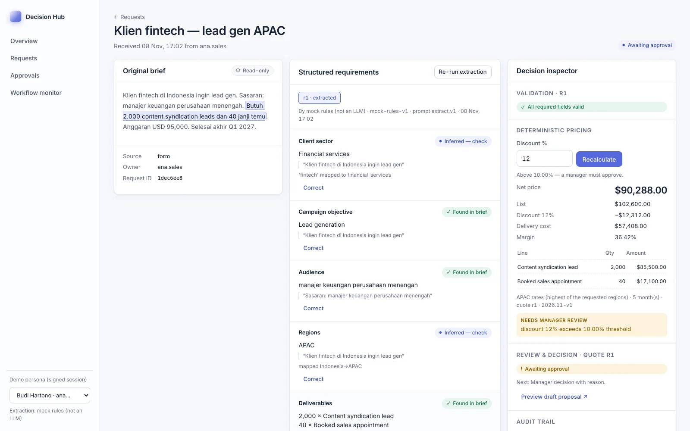
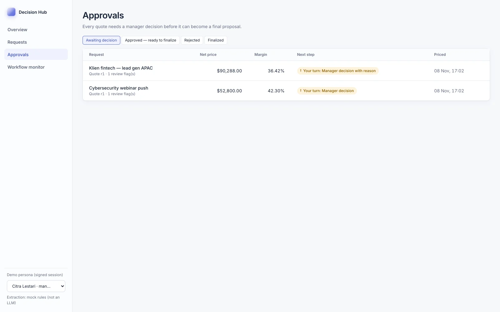
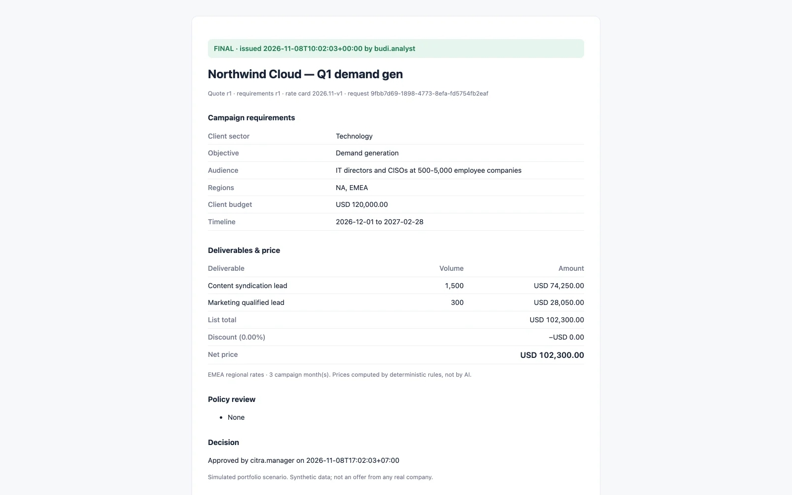
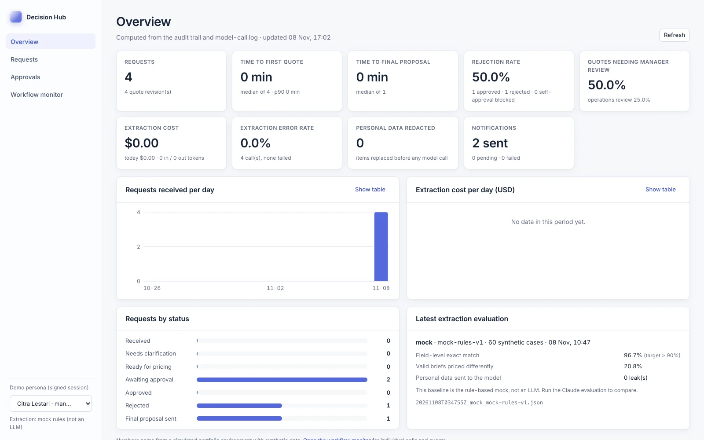

# Decision Hub — B2B AI Decision & Automation Hub (MVP)

**Product page:** https://dzahyk.github.io/decision-hub/ (static, GitHub Pages) · the full app runs locally with `docker compose up`.

Deal Desk workflow: a free-text campaign brief becomes validated structured requirements,
a deterministic, policy-flagged quote, and an audit trail. AI suggests fields; code decides prices;
humans decide outcomes. Spec: *Project 01 Master Specification, Draft v1.1*.

**Status: Phase 4 done** — intake → extraction → validation → correction → pricing →
operations feasibility → manager approval → exactly-once final proposal → mock email/CRM → audit.
Phase 3 adds the Claude extraction adapter, PII redaction, cost guards and a 60-case evaluation set.
Phase 5 adds the Overview dashboard, workflow monitor, Playwright E2E + accessibility tests, CI and a
single-container deployment. Phase 6 adds the public product page at `/welcome` and real-UI screenshots for the
portfolio case study. Remaining: hosting and the live Claude evaluation.

All data is synthetic. Rate card numbers are portfolio fixtures, not real prices.

## What it does, and how

A sales team receives a campaign brief as free text. Decision Hub turns it into a priced, approved, auditable
proposal. **AI suggests fields, code decides the price, a person decides the outcome.**

<table>
<tr>
<td width="50%"><br><sub><b>Request workspace.</b> The brief on the left, the extracted fields in the middle (each quotes its source sentence), pricing and the review flag on the right.</sub></td>
<td width="50%"><br><sub><b>Approvals.</b> The manager's queue: price, margin, review flags and whose turn it is.</sub></td>
</tr>
<tr>
<td width="50%"><br><sub><b>Final proposal.</b> Requirements, the deterministic price, policy review and the recorded decision.</sub></td>
<td width="50%"><br><sub><b>Overview.</b> Metrics computed from the audit trail, plus the latest extraction evaluation (96.7% field match, 20.8% pricing mismatch for the rule-based baseline).</sub></td>
</tr>
</table>

| Feature | What it does | How it works |
|---|---|---|
| **Brief intake** | Sales pastes a brief; it becomes a tracked request. | `POST /v1/briefs` with an `Idempotency-Key`, so a repeat returns the same request. Stored in PostgreSQL. |
| **Structured extraction with sources** | Reads the brief into seven requirement fields: sector, objective, audience, regions, deliverables, budget, timeline. Every value quotes its source sentence; guesses are labelled "Inferred, check" and missing values stay missing. | An extractor interface with two providers: a labelled rule-based mock (default) and an optional Claude adapter. The model output has no price or approval field. Personal data is replaced with placeholders before any model call. |
| **Correction as new revisions** | An analyst fixes or confirms fields. | Each correction creates a new `requirement_revisions` row; nothing is overwritten. |
| **Deterministic pricing and policy flags** | Prices the quote and flags what needs a person, e.g. a discount above 10% needs manager review. | Plain code over a versioned rate card (regional rates, volume, discount, delivery cost, margin). The same input always gives the same price. |
| **Operations feasibility** | Operations confirms whether off-catalog work can be delivered. | Flagged quotes go to operations before they reach approval. |
| **Role-based approval** | A manager approves or rejects one exact quote revision, with a reason when a flag applies. | Five roles (sales, analyst, operations, manager, auditor) with server-signed HttpOnly sessions. Whoever created a request cannot approve it. |
| **Final proposal and audit trail** | Issues the proposal once, sends a mock email and CRM update, and records every step. | Exactly-once finalization; every state change is written to `audit_events`, which the Overview and the workflow monitor read from. |

Details: [docs/ARCHITECTURE.md](docs/ARCHITECTURE.md) (layers, rules the code enforces, pricing formula),
[docs/TRACEABILITY.md](docs/TRACEABILITY.md) (requirement → code → test), [docs/PLAN.md](docs/PLAN.md).

## Run locally

Needs Python 3.12 + `uv`, Node 20+, PostgreSQL running locally.

```bash
createdb decision_hub && createdb decision_hub_test
cd backend && uv sync && uv run alembic upgrade head && uv run python -m app.seed
uv run uvicorn app.main:app --port 8010
```

```bash
cd frontend && pnpm install && pnpm dev   # http://localhost:5173 (proxies /v1 to :8010)
```

Pick a demo persona in the sidebar: Sales creates briefs; Analyst extracts, corrects, prices and
finalizes; Operations checks feasibility; Manager approves or rejects. Personas sign in through a
server-signed HttpOnly session cookie. Demo mode (password-less persona sign-in) is on by default —
set `DH_DEMO_MODE=false` and `DH_SESSION_SECRET` for anything holding real data.

## Configuration (`backend/.env`, prefix `DH_`)

| Variable | Default | Notes |
|---|---|---|
| `DH_DATABASE_URL` | `postgresql+psycopg:///decision_hub` | |
| `DH_DEMO_MODE` | `true` | Password-less persona sign-in for the demo |
| `DH_SESSION_SECRET` | random per process | Set it, or sessions end on every restart |
| `DH_STATIC_DIR` | empty | Path to the built frontend to serve from the API (set in the Docker image) |
| `DH_COOKIE_SECURE` | `false` | `true` behind HTTPS (Docker image default) |
| `DH_LLM_PROVIDER` | `mock` | `mock` (labelled regex parser, free) or `anthropic` (Claude). |
| `ANTHROPIC_API_KEY` | — | Read by the Anthropic SDK only; never stored in this repo or the database. |
| `DH_LLM_MODEL` | `claude-opus-5-5` | |
| `DH_LLM_EFFORT` | `medium` | `low`…`max`; tune with the eval set |
| `DH_LLM_MAX_TOKENS` / `DH_LLM_TIMEOUT_S` | `16000` / `90` | Per-call output cap and timeout |
| `DH_LLM_DAILY_BUDGET_USD` | `5.0` | Paid extraction stops for the day at this spend (0 = off) |

## Tests

```bash
cd backend && uv run pytest && uv run ruff check app tests
cd frontend && pnpm typecheck
```

64 backend tests: pricing oracle (hand-computed), validation, extractor, sessions, approvals,
concurrent finalize, outbox fault injection and rate card replay — named after the spec's UAT IDs,
run against a real Postgres test DB through the real migrations.

## End-to-end tests

```bash
createdb decision_hub_e2e          # once
cd frontend && npx playwright install chromium   # once (Playwright 1.62.1)
npx playwright test                # builds, resets the e2e DB, serves on :8031, runs desktop + mobile
```

Covers the full journey (brief → extraction → quote → approval → final proposal), the incomplete-brief block,
role restrictions, the dashboard, axe WCAG 2.2 AA checks and phone-width overflow.

## Product page & screenshots

`/welcome` is the public product page (no sign-in): pearl hero with a slow dolly and light sweep that stop
under `prefers-reduced-motion`, the five-step mechanism shown with real UI, guardrails, and measured evidence.

```bash
cd frontend && npx playwright test -c playwright.capture.config.ts   # real-UI screenshots -> shots/ and public/landing/shots/
```

The capture builds its scenario through the real API on the isolated e2e database and encodes WebP in Chromium.

## Deploy

The product page is published to GitHub Pages by `.github/workflows/pages.yml` (`pnpm run build:pages`).
The full app needs a server and Postgres: run it locally with Docker, or use `render.yaml` on Render.

### One container

```bash
docker compose up --build          # app + Postgres on http://localhost:8000
```

The image builds the frontend, serves it from FastAPI, runs migrations and the idempotent demo seed on start,
and runs as a non-root user. On a host, set `DH_DATABASE_URL`, a long random `DH_SESSION_SECRET`, and keep
`DH_COOKIE_SECURE=true` (the image default). Leave `DH_DEMO_MODE=true` only for the public portfolio demo.

## Evaluation (A-FR-15)

```bash
cd backend
uv run python -m app.eval.run                                # free, mock provider
uv run python -m app.eval.run --provider anthropic           # prints a cost estimate, then stops
uv run python -m app.eval.run --provider anthropic --yes     # real run (~$3 for 60 cases)
```

60 synthetic, labelled briefs in `backend/eval/cases.jsonl` (regenerate with `eval/make_cases.py`).
Reports go to `backend/eval/reports/` with model, prompt version, effort, commit, per-field precision/recall,
pricing mismatch rate, PII leak count, latency, tokens, cost and an error list.

## Docs
- `docs/PLAN.md` — phases, environment constraints, exit gates
- `docs/ARCHITECTURE.md` — layers, rules the code enforces, pricing formula
- `docs/TRACEABILITY.md` — requirement → code → test, plus decisions and known limits
